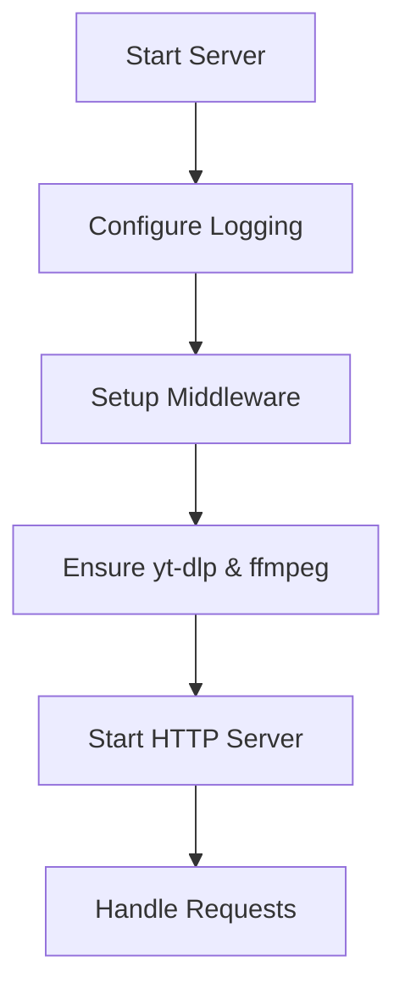

# YTDL — Development Guide

## Getting Started

### Prerequisites

- **Node.js** 18+ (download from [nodejs.org](https://nodejs.org/))
- **pnpm** 8+ (install via `npm install -g pnpm`)
- **Git** (for version control)
- **TypeScript** (installed as dev dependency)

### Initial Setup

```bash
# Clone the repository
git clone <repository-url>
cd YTDL

# Install all dependencies
pnpm install

# Build TypeScript
pnpm run build

# Start in development mode
pnpm run dev
```

---

## Project Structure

```
YTDL/
├── bin/                    # yt-dlp and ffmpeg binaries (auto-downloaded)
├── dist/                   # Compiled JavaScript output
├── logs/                   # Winston log files
├── public/                 # Static frontend (served by Express)
│   ├── index.html          # SPA entry point
│   ├── styles.css          # All styles (1083 lines)
│   ├── app.js              # Frontend logic (~400 lines)
│   └── icon.png            # Application icon
├── src/                    # TypeScript source
│   ├── server.ts           # Express server
│   ├── main.ts             # Electron main process
│   ├── preload.ts          # Electron preload script
│   ├── security.ts         # Security utilities
│   ├── config.ts           # Configuration (Zod)
│   ├── errors.ts           # Error classes
│   └── __tests__/          # Jest tests
├── temp/                   # Temporary download files (auto-cleaned)
├── package.json
├── tsconfig.json           # TypeScript configuration
├── eslint.config.js        # ESLint configuration
├── jest.config.js          # Jest configuration
├── .gitignore
├── .env.example            # Environment variables reference
├── .npmrc                  # pnpm/npm configuration
├── verify-build.js         # Project verification script
├── server.js               # Legacy JS server (use src/server.ts)
├── main.js                 # Legacy JS Electron (use src/main.ts)
├── preload.js              # Legacy JS preload (use src/preload.ts)
├── README.md               # Project overview
├── ARCHITECTURE.md         # Architecture documentation
├── API.md                  # API reference
├── DEVELOPMENT.md          # This file
└── TROUBLESHOOTING.md      # Common issues
```

---

## Backend Development

### File Overview

| File | Purpose | Key Features |
|------|---------|-------------|
| `src/server.ts` | Express HTTP server | 3 API endpoints, yt-dlp integration, logging |
| `src/security.ts` | Security module | URL validation, filename sanitization, CSP |
| `src/config.ts` | Configuration | Zod schema, env variable parsing |
| `src/errors.ts` | Error handling | Custom error classes, error formatting |
| `src/main.ts` | Electron main | Window creation, IPC, binary paths |
| `src/preload.ts` | Electron preload | contextBridge, safe IPC exposure |

### Server Architecture (`src/server.ts`)

The server is constructed in several phases:



**Middleware Stack (order matters):**

```typescript
app.use(helmet({...}));           // 1. Security headers
app.use(cors());                  // 2. CORS
app.use(compression());           // 3. Response compression
app.use(express.json({...}));     // 4. Body parsing
app.use(express.static(...));     // 5. Static files
```

### Adding a New API Endpoint

1. Add the route handler in `src/server.ts`:
```typescript
app.get("/api/new-endpoint", async (req: Request, res: Response) => {
  try {
    // Your logic here
    res.json({ result: "success" });
  } catch (err) {
    logger.error("New endpoint error:", err);
    res.status(500).json({ error: (err as Error).message });
  }
});
```

2. Add validation if needed:
```typescript
const someParam = req.query.someParam as string;
if (!someParam) {
  res.status(400).json({ error: "Missing someParam" });
  return;
}
```

3. Add logging:
```typescript
logger.info("New endpoint called", { someParam });
```

### yt-dlp Integration

The `runYtDlp()` function is the core of the download pipeline:

```typescript
function runYtDlp(args: string[]): Promise<string> {
  // Spawns yt-dlp as child process
  // Captures stdout (JSON output)
  // Captures stderr (error messages)
  // Rejects on non-zero exit codes
}
```

Key yt-dlp arguments used:

| Purpose | Arguments |
|---------|-----------|
| Get metadata | `--dump-json --no-warnings --no-playlist` |
| Get filename | `--print filename -o <template>` |
| Download video | `-f bestvideo+bestaudio --embed-metadata` |
| Download audio | `-f bestaudio -x --audio-format mp3` |

### Security Module (`src/security.ts`)

**URL Validation Flow:**

```
validateUrl(url)
  → new URL(url)                    // Parse URL
  → protocol check                  // Only http/https
  → hostname check                  // Block localhost, private IPs
  → YouTube domain check            // Only youtube.com, youtu.be, etc.
  → return true/false
```

**Filename Sanitization:**

```
sanitizeFilename(name)
  → Remove ../ path traversal       // Prevent directory escape
  → Replace unsafe characters       // [^\w\s\-.()\[\]] → _
  → Truncate to 255 chars           // Filesystem limit
  → Return safe filename
```

---

## Frontend Development

### File Overview

| File | Lines | Purpose |
|------|-------|---------|
| `public/index.html` | 236 | SPA HTML structure |
| `public/styles.css` | 1083 | All styling (cyberpunk theme) |
| `public/app.js` | ~400 | Application logic |
| `public/icon.png` | — | Application icon |

### State Object (`public/app.js`)

```javascript
const state = {
  videoInfo: null,        // Response from /api/info
  formats: [],            // Available formats array
  selectedFormatId: null, // User-selected format ID
  downloadMode: "video",  // "video" | "audio"
  isDownloading: false,   // Prevents double-clicks
  isElectron: false,      // Detected via window.electronAPI
  history: [],            // Download history array
};
```

### DOM References

All DOM elements are cached once in the `dom` object for performance:

```javascript
const dom = {
  urlInput: $("#url-input"),
  fetchBtn: $("#fetch-btn"),
  formatSelect: $("#format-select"),
  downloadBtn: $("#download-btn"),
  // ... etc
};
```

### Key Functions

| Function | Purpose | Called When |
|----------|---------|-------------|
| `fetchVideoInfo()` | GET /api/info | Enter key, fetch button click |
| `renderVideoInfo()` | Update video card | After successful /api/info |
| `populateFormats()` | Populate select dropdown | After mode change or info fetch |
| `startDownload()` | GET /api/download | Download button click |
| `showToast()` | Show notification toast | Error/success/info events |
| `addHistory()` | Save to localStorage | After successful download |
| `renderHistory()` | Refresh history panel | History change, init |
| `checkHealth()` | GET /api/health | Startup, every 60s |

### Styling Guidelines

YTDL uses CSS custom properties for theming:

```css
/* Core colors */
--neon-cyan: #00f0ff;
--neon-pink: #ff007f;
--neon-purple: #9d4edd;

/* Glassmorphism */
--glass-bg: rgba(10, 10, 30, 0.45);
--glass-border: rgba(255, 255, 255, 0.08);

/* Layout */
--radius-lg: 18px;
--transition: 0.3s cubic-bezier(0.25, 0.8, 0.25, 1);
```

To add a new component, follow the glassmorphism pattern:

```css
.my-component {
  background: var(--glass-bg);
  border: 1px solid var(--glass-border);
  border-radius: var(--radius-lg);
  backdrop-filter: blur(30px);
  box-shadow: var(--shadow-card);
  transition: all var(--transition);
}
```

---

## Electron Development

### Running Electron

```bash
# Build TypeScript first
pnpm run build

# Run in development mode
pnpm run electron:dev
```

### IPC Communication

```
Renderer (app.js)              Main Process (main.ts)
     │                               │
     │──invoke("window:minimize")───>│──mainWindow.minimize()
     │                               │
     │──invoke("window:maximize")───>│──mainWindow.maximize()
     │                               │
     │──invoke("window:close")──────>│──mainWindow.close()
     │                               │
     │──invoke("window:isMaximized")>│──return boolean
```

### Adding a New IPC Channel

1. **Preload** (`src/preload.ts`):
```typescript
contextBridge.exposeInMainWorld("electronAPI", {
  myFunction: () => ipcRenderer.invoke("my-channel"),
});
```

2. **Main** (`src/main.ts`):
```typescript
ipcMain.handle("my-channel", () => {
  return doSomething();
});
```

3. **Renderer** (`public/app.js`):
```javascript
if (state.isElectron) {
  const result = await window.electronAPI.myFunction();
}
```

### Building for Distribution

```bash
# Build portable executable (single .exe file)
pnpm run electron:build

# Build directory (folder with all files)
pnpm run electron:build:dir
```

The portable build uses:
- `electron-builder` with `portable` target
- `bin/yt-dlp.exe` and `bin/ffmpeg.exe` bundled as `extraResources`
- Resolved at runtime via `process.resourcesPath`

---

## Testing

### Running Tests

```bash
# Run all tests
pnpm run test

# Watch mode
pnpm run test:watch

# With coverage
pnpm run test:cov
```

### Writing Tests

Tests are in `src/__tests__/` and use **Jest** with **supertest**.

**Test file structure:**
```typescript
import request from "supertest";
import { app } from "../server";

describe("API Endpoint", () => {
  it("should return expected result", async () => {
    const response = await request(app).get("/api/health");
    expect(response.status).toBe(200);
    expect(response.body).toHaveProperty("status");
  });
});
```

**Setup file** (`src/__tests__/setup.ts`):
```typescript
import "jest-extended/all";

process.env.NODE_ENV = "test";
process.env.PORT = "3001";
jest.setTimeout(30000);
```

### Test Coverage Goals

| Area | Coverage Target |
|------|----------------|
| API endpoint validation | 100% (parameter errors) |
| Security functions | 100% (URL validation, sanitization) |
| Error handling | 90%+ (error scenarios) |
| Download endpoints | 80% (success + error paths) |

---

## Linting & Formatting

```bash
# Check for linting errors
pnpm run lint

# Fix linting errors automatically
pnpm run lint -- --fix

# TypeScript type checking
pnpm run typecheck
```

The project uses:
- **ESLint** with TypeScript plugin for code quality
- **Prettier** (via eslint-config-prettier) for formatting
- **lint-staged** for pre-commit hooks

---

## TypeScript Configuration

Key `tsconfig.json` settings:

| Setting | Value | Purpose |
|---------|-------|---------|
| `target` | `ES2022` | Modern JavaScript output |
| `module` | `commonjs` | Node.js compatible modules |
| `esModuleInterop` | `true` | Better import compatibility |
| `strict` | `true` | Full type safety |
| `outDir` | `./dist` | Compiled output directory |
| `rootDir` | `./src` | Source directory |

---

## Environment Configuration

**`.env.example`** provides reference values. Copy to `.env` to customize:

```bash
cp .env.example .env
```

For development, the defaults are usually sufficient. The server logs the active configuration on startup.

---

## Performance Tips

1. **Memory**: yt-dlp processes can be memory-intensive for high-resolution videos. Set `MAX_FILE_SIZE` appropriately.
2. **Temp Files**: The `temp/` directory is cleaned hourly. Files older than 24 hours are removed.
3. **Logs**: Winston logs to `logs/combined.log` and `logs/error.log`. These can grow large; consider log rotation.
4. **Rate Limiting**: In production, set `RATE_LIMIT_MAX_REQUESTS` to a reasonable value to prevent abuse.

---

## Common Development Tasks

### Adding a New Dependency

```bash
# Production dependency
pnpm add <package-name>

# Dev dependency
pnpm add -D <package-name>
```

### Updating yt-dlp

The server auto-downloads the latest yt-dlp on startup if not found. To force an update, delete or rename the binary in `bin/` and restart.

### Debugging yt-dlp

Set `LOG_LEVEL=debug` in your environment to see full yt-dlp output:

```bash
LOG_LEVEL=debug pnpm start
```

---

## Git Workflow

```bash
# Create feature branch
git checkout -b feature/my-feature

# Make changes and commit
git add .
git commit -m "feat: add my feature"

# Keep branch updated
git fetch origin
git rebase origin/main

# Push and create PR
git push origin feature/my-feature
```

Commit messages follow [Conventional Commits](https://www.conventionalcommits.org/):
- `feat:` new feature
- `fix:` bug fix
- `docs:` documentation
- `refactor:` code restructuring
- `test:` testing
- `chore:` maintenance